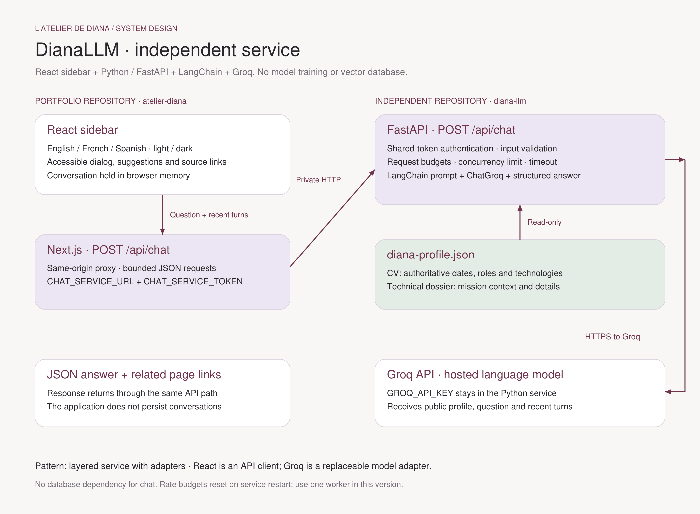
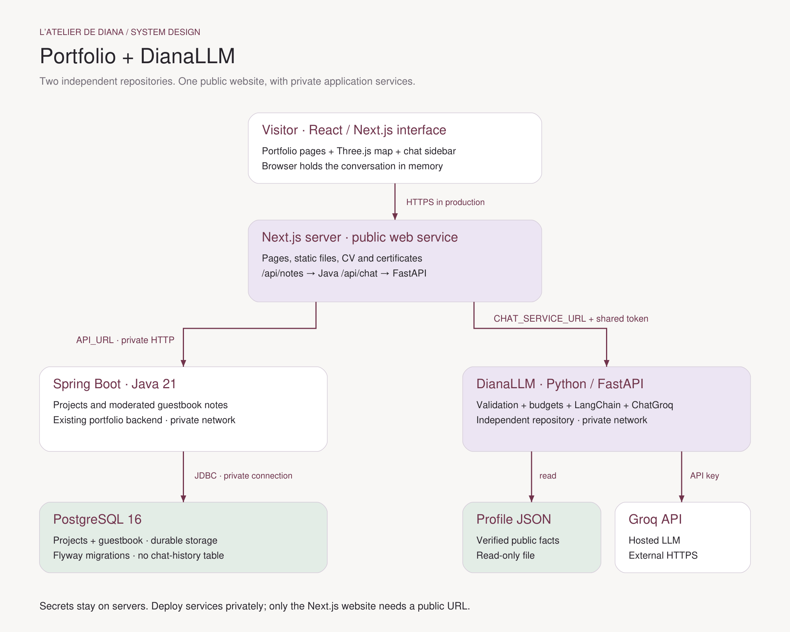

# DianaLLM

A personal portfolio assistant for Diana Torres. Visitors ask about her experience, projects, skills, education and creative interests in English, French or Spanish. A reusable React sidebar connects to an independent Python service through the portfolio's same-origin `/api/chat` endpoint.

DianaLLM uses an existing hosted language model with a curated profile. It does not train a model, execute tools, browse the web or persist conversations. Responses may still contain mistakes; the evaluation checklist is part of the project.



## Stack and architecture pattern

| Layer | Technology | Responsibility |
| --- | --- | --- |
| Chat interface | React 19, JavaScript, CSS | Accessible sidebar, three languages, suggestions, retry/reset, source links |
| Portfolio gateway | Next.js route handler | Same-origin `/api/chat`; service credentials remain server-side |
| Independent API | Python 3.11, FastAPI, Pydantic, Uvicorn | Authentication, input limits, request budgets, timeouts |
| AI orchestration | LangChain Core + `langchain-groq` | Prompt, bounded conversation history, structured response |
| Model provider | Groq API | `openai/gpt-oss-20b`, configurable through `GROQ_MODEL` |
| Knowledge | `data/diana-profile.json` | Curated public facts, source precedence and provenance |
| Verification | pytest, HTTPX, portfolio Playwright tests | API contract, failures, integration and keyboard/mobile behaviour |
| Deployment | Docker | Independent private service, non-root process |

Pattern: **layered service with adapters**, kept small. FastAPI is the HTTP layer; `service.py` contains prompt/answer orchestration; ChatGroq is the provider adapter. React is an independent API client. This version injects the whole small profile into context. It is not a vector-search/RAG pipeline, and PostgreSQL is not a dependency of the chat.

## Local setup

Use Python **3.11** and keep this repository next to `diana-creative-portfolio` for the supplied integration scripts.

```sh
cd diana-llm
python3.11 -m venv .venv
source .venv/bin/activate
pip install -r requirements.lock
python scripts/configure-local.py
```

Edit `.env` locally and supply `GROQ_API_KEY`. The setup script creates a random `CHAT_SERVICE_TOKEN` and, when the sibling portfolio exists, writes the same token to its ignored `frontend/.env.local`. It preserves an existing Groq key and never prints credentials.

```sh
uvicorn app.main:app --host 127.0.0.1 --port 8001 --no-access-log
```

`GET http://127.0.0.1:8001/health` reports service health and whether credentials are configured. A missing Groq key produces a genuine 503 on chat requests, not a simulated answer. Restart Python after editing environment variables.

## Connect the portfolio

```sh
node scripts/sync-portfolio.mjs ../diana-creative-portfolio
```

This copies `react/ChatSidebar.jsx` and `react/chat.css` into the portfolio's `frontend/components/diana-llm/`. The independent repository owns these two files; rerun the script after editing them. It does not replace the portfolio header or proxy. The matching gateway source is included in [`integration/next-route.js`](integration/next-route.js); copy it to `app/api/chat/route.js` when integrating into another Next.js project. The Docker overlay is also included in `integration/`.

The local portfolio working copy includes a Next.js `app/api/chat/route.js` gateway and mounts the sidebar from `components/Shell.js`. These portfolio integration changes have not been pushed to `atelier-diana`; the independent chatbot sources are published here. For a fresh portfolio checkout, copy `integration/next-route.js` to `frontend/app/api/chat/route.js`, sync the two React files, and mount the sidebar with the controlled `open`/`onClose` props shown below. Server environment:

```dotenv
CHAT_SERVICE_URL=http://127.0.0.1:8001
CHAT_SERVICE_TOKEN=the-same-secret-as-the-python-service
```

Then run the portfolio's existing Java service and Next.js frontend as documented in its README. Rebuild/restart Next.js after changing server environment variables when using a production build. Open `http://127.0.0.1:3000/en` and choose **DianaLLM**. The button in About opens the same sidebar.

To use the component elsewhere, install React 19, copy the two `react/` files and mount:

```jsx
<ChatSidebar locale="en" open={open} onClose={() => setOpen(false)} endpoint="/api/chat" />
```

The component does not call Groq directly and must point to a server gateway you control.

## API contract

`POST /api/chat` on FastAPI requires `Authorization: Bearer <CHAT_SERVICE_TOKEN>`. Browser requests go to Next.js and do not include this secret.

```json
{
  "message": "What did Diana do at Covéa?",
  "locale": "en",
  "history": [{"role": "user", "content": "Tell me about her experience."}]
}
```

```json
{
  "answer": "An answer based on the curated profile…",
  "sources": [{"id": "cv-2026", "title": "Latest CV · Diana Torres", "path": "/en/journey"}]
}
```

Limits: 1,500 characters per question; eight history turns with at most 1,200 characters each and 8,000 total; 16 KiB request body; 2,048 completion tokens (including reasoning); three concurrent provider calls. Default global budgets: 20 requests/minute and 200/day per process. Run **one worker**. These limits reset on restart and are not a durable billing ceiling. Configure provider spend controls; use shared durable limits before horizontal scaling.

Statuses: 401 invalid service token, 413 body too large, 422 invalid fields, 429 local or provider rate limit, 502 provider/structured-output failure, 503 missing configuration, 504 timeout. Provider errors, keys and prompts are never returned to the client. Source IDs are checked against a server-owned catalogue; URLs cannot be supplied by the model. Related-page links are navigation aids, not proof that every generated claim is correct.

## Profile sources and precedence

The latest supplied CV, **Diana-Torres-CV-FR (2).pdf**, controls dates, titles and technologies. **DianaTORRES_DossierTechnique (2).pptx** supplies descriptive project detail. Original documents are not committed; their hashes and slide references are recorded in the JSON.

- Covéa: JavaScript / Playwright / Jenkins, following the CV rather than the dossier's conflicting tool list.
- Assura and Covéa: assignments within Leanovia in 2022; no invented mission-month boundaries.
- TransUnion: Backend Developer, January–October 2023. GML Software is retained as a consultancy previously confirmed by Diana.
- ENGIE and Seine-Saint-Denis: assignments within Leanovia since October 2023; detailed mission dates from the dossier are not asserted as CV-confirmed.
- Phone number, precise address and agency branding are excluded. The excluded agency is not a source of employment claims.
- Owner-confirmed hobbies, Wave IT Labs bootcamp and independent projects have separate provenance. The marketing assistant remains in progress. Undocumented results, salary and availability are unknown.

Edit the JSON and restart FastAPI to update knowledge. Follow `docs/evaluation.md` to check factual behaviour after changes.

## Tests

See the [verification record](docs/verification.md) for checks actually completed.

```sh
python -m pytest -q
```

Tests mock the provider and never consume Groq credit. They verify the real API, schema and orchestration contract; they do not establish live model accuracy. `scripts/evaluate-live.py` is an explicit, paid-provider check that requires a configured local service and evaluates representative questions. It saves no conversations to this repository.

## Deployment and security

Deploy the Dockerfile as a **private service** listening on port 8001, in the same network/region as the portfolio server. Set `GROQ_API_KEY`, `GROQ_MODEL` and `CHAT_SERVICE_TOKEN` in hosting secret settings. The public Next.js service receives only the private service URL and shared token. Keep the Java/PostgreSQL services as they are.

The portfolio provides `compose.chat.yaml` for local Docker integration. From the portfolio root, with its database password configured:

```sh
docker compose --env-file .env --env-file ../diana-llm/.env -f compose.yaml -f compose.chat.yaml up --build
```

No Python port is published by that overlay. Production HTTPS belongs at the public website ingress. Chat data (question, recent history and selected public profile) is sent to Groq. The application does not persist conversations and disables LangSmith tracing; provider retention is governed separately by your Groq account/policies. Never add confidential documents to this public profile. The model has no tools and cannot execute generated text.

## Complete portfolio architecture



Editable SVG versions are alongside the PNG images. `python scripts/architecture.py` regenerates SVGs; PNG export can be performed with PyMuPDF.

## References

- [LangChain ChatGroq](https://docs.langchain.com/oss/python/integrations/chat/groq)
- [Groq supported models](https://console.groq.com/docs/models)
- [FastAPI testing](https://fastapi.tiangolo.com/tutorial/testing/)
- [Portfolio repository](https://github.com/diisat/atelier-diana)

The default model is available in the connected Groq account and supports JSON mode ([Groq model documentation](https://console.groq.com/docs/model/openai/gpt-oss-20b)). If changing providers or models, review the supported reasoning and structured-output parameters in `app/service.py`.
